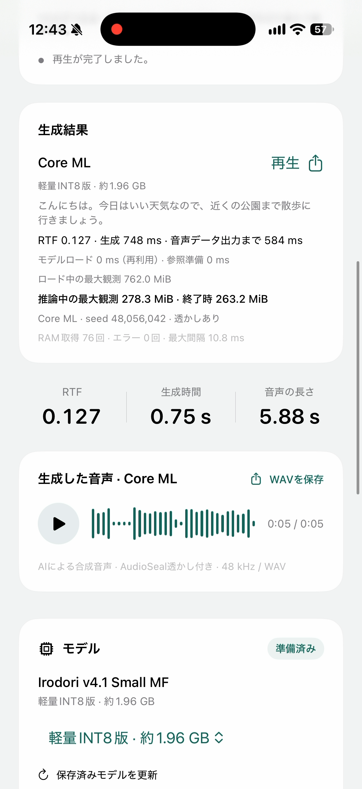
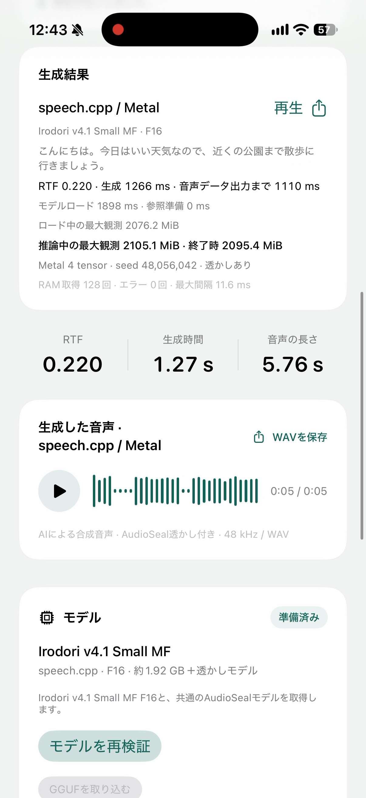
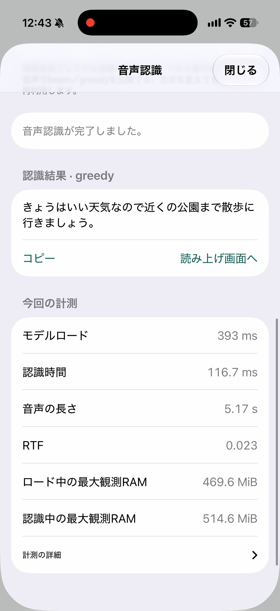

# Irodori TTS for iPhone

Irodori TTS v4.1 Small MFをiPhoneで生成・試聴するアプリとSwift SDKです。
Core ML / speech.cpp・Metalを切り替え、ロード時間・推論時間・RTF・RAMを比較できます。
耳ボタンからReazonSpeech Q4_Kの音声認識も試せます。Core ML SDKとサンプルはApple Silicon Macにも対応します。

[English](docs/README.en.md) · [サンプル操作](docs/SAMPLES.md) · [SDK導入](docs/GETTING_STARTED.md) · [API](docs/API.md)

## iPhone比較アプリを使う

Apple Silicon MacとXcodeを用意し、リポジトリを取得するか、プロジェクトZIPを展開します。Xcode 27.0でビルドを確認しています。
ビルド済みspeech.cppライブラリを同梱しているため、CMake・Ninja・Pythonのインストールやセットアップコマンドは不要です。

1. GitHubの **Code → Download ZIP** で取得して展開します。ReleaseのプロジェクトZIPも使えます。
2. 展開したフォルダの **`Examples/IrodoriComparison.xcodeproj`** をXcodeで開きます。
3. iPhoneをMacへ接続し、端末側の信頼確認と開発者モードの設定を済ませます。
4. Xcodeでtarget **IrodoriiOS → Signing & Capabilities** を開き、**Automatically manage signing** をオンにして、自分の **Team** と一意の **Bundle Identifier** を設定します。
5. 上部のschemeを **IrodoriiOS**、実行先を接続したiPhoneにして、**Run（⌘R）** を押します。

Teamが選べない場合のApple Account登録、開発者モード、設定画面の開き方は[初回のビルド手順](docs/SAMPLES.md)にあります。
Xcodeが同梱ライブラリを自動展開してビルドします。モデルは起動後にアプリから取得します。

Gitで取得する場合は次を使えます。

```sh
git clone https://github.com/Corvelis/irodori-tts-iphone.git
cd irodori-tts-iphone
open Examples/IrodoriComparison.xcodeproj
```

アプリが起動したら、次の順で試せます。最初は片方のモデルだけで構いません。

1. Core MLまたはspeech.cppを選び、「モデルをダウンロード」を押します。Core MLは現行版／軽量INT8版、speech.cppはF16を取得します。
2. 参照音声なしで「生成して再生」を押します。生成が完了すると再生が始まります。録音・ファイル取り込みで声を指定することもできます。
3. 「もう一度再生」は保存済みWAVを再生します。同じ方式の連続生成ではモデルを再利用し、方式切替時には先に解放します。
4. 両モデルを取得すると「両方式で生成して比較」で順番に生成できます。結果欄には選択中の方式の情報を表示します。
5. 耳ボタンから任意のReazonSpeech Q4_Kモデルを取得し、録音・ファイル入力でbeam／greedyを試せます。[音声認識ガイド](docs/ASR.md)を参照してください。

モデルはWi-Fiで取得し、サイズとSHA-256を検証します。取得後の生成・認識は端末内で動作します。
方式別の最新WAVは再起動後も試聴できます。RAMは約10 ms間隔で測定したアプリ全体のphysical footprintの最大観測値です。
[計測値の意味と性能測定](docs/VALIDATION.md)に、ロード・推論の区分と測定条件をまとめています。
speech.cppの推論には実機iPhoneが必要です。Simulatorでは画面を確認できます。

## 操作動画とスクリーンショット

Core MLとspeech.cpp / Metalの音声生成・試聴、耳ボタンからの音声認識を紹介しています。
約46秒・音声付きです。再生ボタンを押し、音声を聴く場合はプレイヤーのミュートを解除してください。

https://github.com/user-attachments/assets/85402c9b-d4df-4186-8496-d47dbe176d64

[MP4を開く・ダウンロード](docs/media/irodori-demo-ja.mp4)

| Core ML・軽量INT8 | speech.cpp / Metal | 音声認識・greedy |
| --- | --- | --- |
| [](docs/media/coreml-result.png) | [](docs/media/speechcpp-result.png) | [](docs/media/asr-result.png) |

## Core MLだけのサンプルを使う

```sh
open Examples/IrodoriSamples.xcodeproj
```

iPhoneは `IrodoriiOS`、Macは `IrodoriMac` schemeを選び、自分のSigning TeamとBundle Identifierで実行します。
Core MLサンプルはルートのSDKだけを使用します。CMake / Ninja / speech.cppランタイムの生成は不要です。
モデル取得、音声登録、生成後の自動再生、WAV保存に対応します。

## SDKを自分のアプリへ追加する

| Swift Package / product | 機能 | 追加方法 |
| --- | --- | --- |
| `IrodoriTTS` | Core ML音声合成、AudioSeal、モデル取得、時間・RAM計測、排他モデル管理 | `https://github.com/Corvelis/irodori-tts-iphone.git` のExact Version `0.3.0`、またはリポジトリルートをローカル追加 |
| `IrodoriSpeechCpp` | Metal音声合成、ReazonSpeech Q4_K音声認識 | リポジトリ一式を取得し、`Packages/IrodoriSpeechCpp` をローカル追加。ライブラリは同梱 |

speech.cppパッケージはルートの `IrodoriTTS` を共通部品として参照します。リポジトリの階層を維持してください。
具体的な追加手順と両方式のコードは[SDK導入ガイド](docs/GETTING_STARTED.md)にあります。

```swift
import Foundation
import IrodoriTTS

func makeWAV(engine: IrodoriEngine, models: URL, output: URL) async throws {
    try await engine.prepare(modelDirectory: models)
    try await engine.registerReference(nil)
    let audio = try await engine.synthesize(
        "こんにちは。今日はいい天気ですね。",
        caption: "落ち着いた、やさしい話し方。",
        splitSentences: false
    )
    try audio.writeWAV(to: output)
    print("RTF:", audio.rtf)
}
```

`models` はモデル一式の親フォルダ、`output` はアプリが書き込めるWAV保存先です。出力先の親フォルダを作成してから呼び出します。
engineは連続生成で再利用し、使い終わったら `await engine.release()` を呼びます。SDKの再生処理は呼び出し側で実装します。

## モデルと要件

| 用途・モデル | ダウンロード容量 | 必要なOS |
| --- | ---: | --- |
| Core ML 現行版 | 約2.99 GB | iOS 17 / macOS 14以降 |
| Core ML 軽量INT8版 | 約1.96 GB | iOS 18 / macOS 15以降 |
| speech.cpp TTS F16 | 約1.92 GB＋AudioSeal | iOS 17以降、実機iPhone |
| ReazonSpeech Q4_K | 約357 MB | iOS 17以降、実機iPhone |

Core MLモデルは[Hugging Face](https://huggingface.co/AILogDev/Irodori-TTS-v4.1-Small-MF-CoreML)でも配布しています。
モデルをSDKに内蔵していないため、使う方式の一式を取得してください。モデル原本に加え、取り込みコピーとCore MLコンパイルキャッシュ用の空き容量が必要です。

TTS出力は48 kHz、モノラル、PCM16 WAVです。実行にPythonやONNX Runtimeは不要です。
初回はコンパイル・ロードに時間がかかります。速度とメモリ使用量は端末・文章・参照音声・熱状態によって変わります。

## Mac CLIで生成する

リポジトリのルートで実行します。CLIはCore MLを使用します。

```sh
swift build -c release
.build/release/irodori download --variant standard --destination ../Irodori-CoreML-Standard
.build/release/irodori verify --models ../Irodori-CoreML-Standard
.build/release/irodori synthesize --models ../Irodori-CoreML-Standard --text 'こんにちは。今日はいい天気ですね。' --output ./irodori-output.wav
afplay ./irodori-output.wav
```

軽量版は `--variant light-int8` を使い、別の保存先を指定します。
参照音声は `--reference ./reference.wav`、話し方は `--caption '落ち着いた、やさしい話し方。'` で指定できます。

## ドキュメント

| 目的 | ガイド |
| --- | --- |
| アプリを使う | [サンプル操作](docs/SAMPLES.md) / [音声認識](docs/ASR.md) |
| SDKを組み込む | [導入ガイド](docs/GETTING_STARTED.md) / [Core ML・共通API](docs/API.md) / [speech.cpp API](Packages/IrodoriSpeechCpp/README.md) |
| モデルを取得する | [モデル取得と配置](docs/HUGGINGFACE.md) / [軽量版](docs/COMPACT_MODELS.md) |
| 声・再生・透かしを扱う | [音声登録](docs/VOICE_REGISTRATION.md) / [チャンク再生と停止](docs/STREAMING.md) / [AudioSeal](docs/WATERMARK.md) |
| 速度・品質を確認する | [CLI](docs/CLI.md) / [性能・RAMの測定](docs/VALIDATION.md) / [INT8音質測定](docs/QUALITY.md) |
| エラーを解決する | [トラブル対処](docs/TROUBLESHOOTING.md) |
| ビルド・変換する | [開発手順](docs/DEVELOPMENT.md) / [モデル変換](docs/CONVERSION.md) |
| 配布物・利用条件を確認する | [互換性](docs/RELEASE.md) / [変更点](docs/releases/0.3.0.md) / [ライセンス](docs/LICENSE_REVIEW.md) |

## ライセンス

SDK・サンプルの新規部分はApache-2.0です。モデルと上流由来部分にはMIT / Apache-2.0の部品別条件が適用されます。
[LICENSE](LICENSE)、[NOTICE](NOTICE)、[部品別ライセンス](THIRD_PARTY_NOTICES.md)を参照してください。コミュニティによる変換・実装です。
使用許可のある声を使い、[上流モデルの使用条件](https://huggingface.co/Aratako/Irodori-TTS-v4.1-Small-MF)に従ってください。
